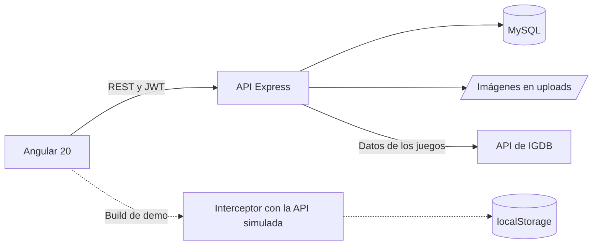

# GamesVote

Catálogo de videojuegos con reseñas de la comunidad: busca juegos, puntúalos del 1 al 10, escribe tu reseña con imágenes y reúne todas las tuyas en «Mis reseñas».

**[Ver la demo](https://vanerb.github.io/gamesvote-angular-node/)**: funciona en el navegador, sin instalar nada.

**Stack:** Angular 20 · Tailwind CSS · Node.js · Express 5 · Sequelize · MySQL · JWT · API de IGDB

## Qué puedes hacer

- **Catálogo:** explorar videojuegos con su portada, plataformas, géneros y nota media, a partir de los datos de IGDB.
- **Búsqueda:** por nombre, con filtro por plataforma y distintos órdenes.
- **Ficha del juego:** descripción, capturas, vídeos y las reseñas de todos los usuarios.
- **Reseñas:** puntuar del 1 al 10, escribir una opinión y añadir imágenes; solo quien la escribe puede editarla o borrarla.
- **Mis reseñas:** todas tus reseñas en un mismo sitio.
- **Perfil:** editar tus datos, tu contraseña y tu foto.

Ver el catálogo y las reseñas es público; para escribir hace falta iniciar sesión.

## Demo

La demo es el frontend compilado en modo `demo`: un interceptor HTTP simula toda la API dentro del navegador, con un catálogo de muestra en lugar de IGDB. Tus cambios se guardan en el `localStorage` de tu navegador y el botón del aviso inferior vuelve a los datos iniciales.

| Correo | Nombre |
| --- | --- |
| `laura@gamesvote.demo` | Laura |
| `carlos@gamesvote.demo` | Carlos |
| `marta@gamesvote.demo` | Marta |

La contraseña de todas es `demo1234`.

## Cómo está construido



La base de datos guarda tres tablas:

| Tabla | Contenido |
| --- | --- |
| `Users` | Cuentas, con la contraseña cifrada con bcrypt. |
| `Valoration` | Nota y reseña de cada usuario, enlazada al juego por su identificador de IGDB. |
| `Images` | Fotos de perfil e imágenes de las reseñas. |

```text
backend/     API de Express: rutas, modelos de Sequelize y cliente de IGDB
frontend/    Web de Angular y build de demo
database/    Base de datos de prueba para MySQL
```

## Decisiones técnicas

- **El catálogo no se copia.** Los datos de los juegos (nombre, portada, plataformas...) se piden a IGDB en cada consulta; la base de datos solo guarda lo que aportan los usuarios.
- **Las credenciales de IGDB se quedan en el servidor.** La API obtiene y renueva el token de Twitch, y el navegador nunca lo ve.
- **Los permisos los decide la API.** Editar o borrar una reseña exige ser su autora, y el registro no deja elegir el tipo de cuenta.
- **Los datos privados no salen.** El modelo de usuario excluye la contraseña y el token de todas las respuestas, y los perfiles públicos solo muestran nombre, apellidos y foto.
- **Configuración en un solo sitio.** La URL de la API está en `frontend/src/environments/environment.ts`, y la clave de las sesiones sale de la variable `JWT_SECRET`.

## Puesta en marcha

Necesitas Node.js 20.19 o superior, MySQL 8 y unas credenciales de la [API de IGDB](https://api-docs.igdb.com/#getting-started), que se crean gratis en la consola de desarrolladores de Twitch.

**API**, en `http://localhost:3000`:

```bash
cd backend
npm install
npm start
```

Antes de arrancarla, crea `backend/.env` a partir de [`backend/.env-sheet`](backend/.env-sheet). Sequelize crea las tablas al arrancar, pero la base de datos tiene que existir (o importar los datos de prueba, que la crean).

**Web**, en `http://localhost:4200`, desde otra terminal:

```bash
cd frontend
npm install
npm start
```

Para abrir la demo en local, sin backend: `npx ng serve --configuration demo`.

### Configuración

| Variable | Por defecto | Uso |
| --- | --- | --- |
| `DB_HOST`, `DB_PORT`, `DB_NAME` | Sin valor | Conexión con MySQL. |
| `DB_USER`, `DB_PASSWORD` | Sin valor | Credenciales de MySQL. |
| `IGDB_CLIENT_ID`, `IGDB_CLIENT_SECRET` | Sin valor | Acceso a la API de IGDB. |
| `JWT_SECRET` | Clave de desarrollo | Firma de las sesiones. Si despliegas el proyecto, define una propia y larga. |
| `PORT` | `3000` | Puerto de la API. |

Si cambias el puerto o la dirección de la API, cambia también `apiUrl` en [`frontend/src/environments/environment.ts`](frontend/src/environments/environment.ts).

### Datos de prueba

[`database/gamesvote_prueba.sql`](database/gamesvote_prueba.sql) crea la base `gamesvote` con usuarios y reseñas inventados (los juegos se enlazan por su identificador de IGDB). No borra nada: si las tablas ya existen, la importación se detiene con un error. Después, pon `DB_NAME=gamesvote` en `backend/.env`.

```bash
mysql -u root -p --default-character-set=utf8mb4 -e "source database/gamesvote_prueba.sql"
```

Cuentas: `nuria@gamesvote.test`, `diego@gamesvote.test` y `elena@gamesvote.test`. La contraseña de todas es `Usuario123*`. Es pública, así que no uses estas cuentas fuera de un entorno local.

## Tests

Todavía no tiene tests propios: solo las pruebas de creación que Angular genera para cada componente.

## Limitaciones conocidas

- La API no tiene tests automáticos.
- Sin credenciales de IGDB, la API no puede mostrar el catálogo.
- Las imágenes se guardan en el disco del servidor, así que un despliegue real necesitaría almacenamiento persistente.

## Autoría

Proyecto de portfolio de **Vanesa Ribera Bautista** ([vanerb](https://github.com/vanerb)). Los datos de los videojuegos proceden de [IGDB](https://www.igdb.com/).
